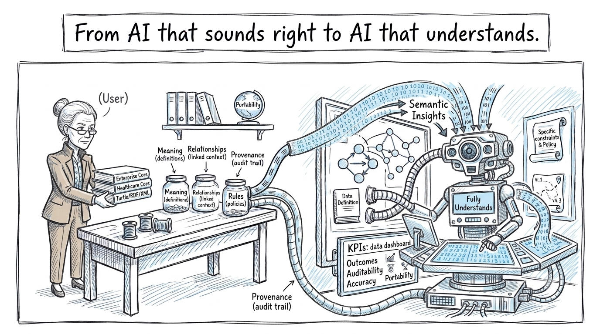
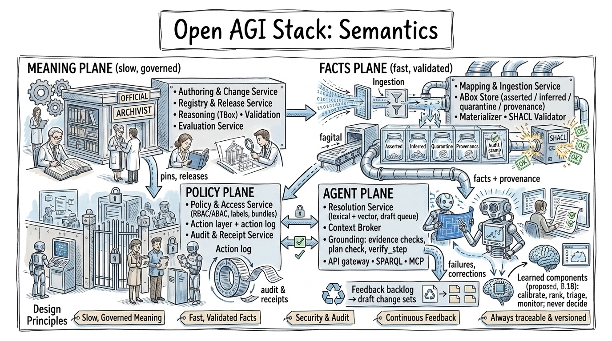
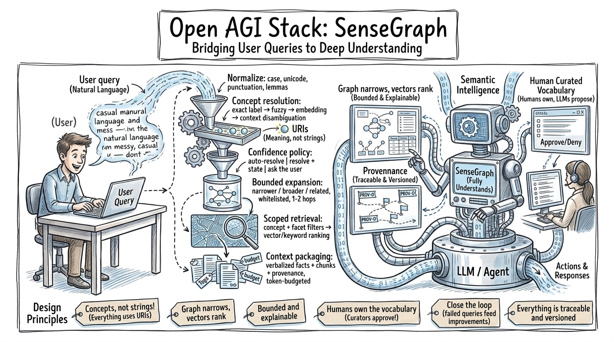
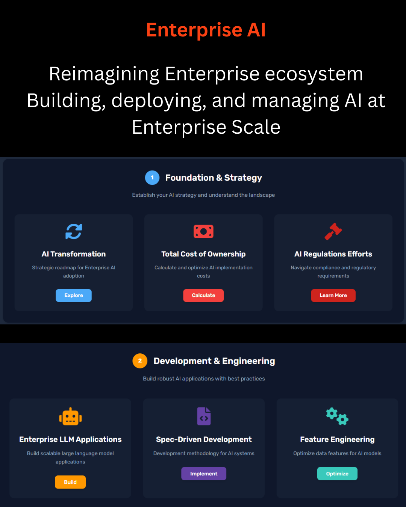
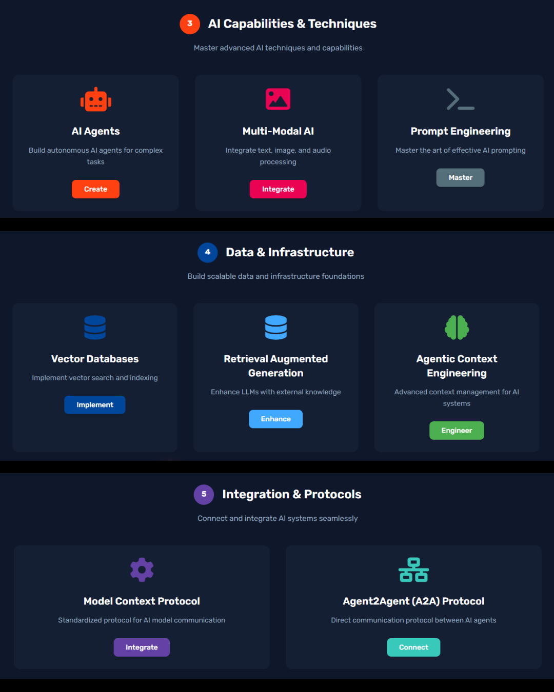
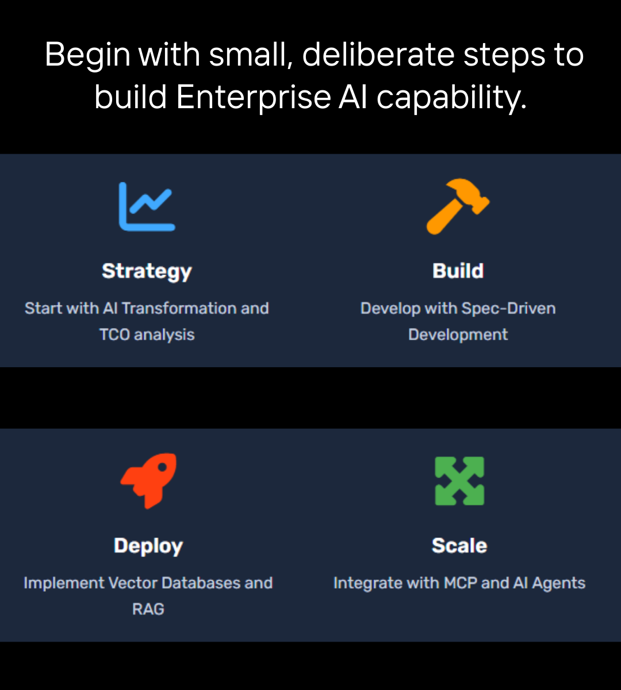

<div align="center">

# Dr. Amit Puri

### Seasoned Technologist · Strategic Enterprise Architect · AI Innovator

[](https://go.amitpuri.com/linkedin)
[](https://twitter.com/iamamitpuri)
[](https://go.amitpuri.com/medium)
[](https://go.amitpuri.com/dev.to)
[](https://go.amitpuri.com/hf)
[](https://go.amitpuri.com/kaggle)
[](https://go.amitpuri.com/badges)
[](https://topmate.io/amitpuri)

<br/>

> *"May your creativity scale like parameters in a neural net, your insights converge like reasoning paths, and your actions embody the initiative of agentic intelligence."*

</div>

---

### 👋 About Me

I am a seasoned technologist with over two decades of experience driving global digital transformation, enterprise cloud adoption, and AI strategy across diverse industries. 

- 🧠 **Enterprise AI & Semantics**: Pioneering semantic intelligence architectures that give autonomous agents deterministic, verifiable context.
- ☁️ **Cloud & Modernization**: Guiding large-scale cloud native strategies, resilient platform engineering, and digital modernization programs.
- 🚀 **Agentic Systems**: Bridging unstructured human intent to grounded knowledge graphs and safe, policy-bounded agent execution.
- ✍️ **Author & Mentor**: Passionate advocate for clean engineering, developer empowerment, and technology mentorship.

---

<div align="center">

# 🌐 Open AGI Stack

### *The Semantic Intelligence Layer for Enterprise AI*

**From AI that sounds right to AI that truly understands.**  
*Give your enterprise agents the business context your people already carry.*

<br/>

[](https://www.openagistack.com/articles/open-agi-stack-semantic-article/)

[📖 Read the Semantic Intelligence Architecture](https://www.openagistack.com/articles/open-agi-stack-semantic-article/) · [☕ Why Bad Data Gets In: The $5 Coffee Order](https://www.openagistack.com/articles/The-5-dollar-Coffee-Order-Why-Bad-Data-Gets-In-and-How-to-Stop-It/)

</div>

Enterprise AI stalls on **meaning**, not model capability. **Open AGI Stack Semantics** translates human-curated policies, business glossaries, and domain schemas into executable semantic intelligence that AI agents can **verify, cite, and run**.

---

## 🏛️ The Four-Plane Operating Architecture

An enterprise operating blueprint designed to decouple slow, human-governed business meaning from high-speed, validated operational facts.

<div align="center">

[](https://www.openagistack.com/images/products/semantic-intelligence-semantics.png)

</div>

### Architectural Overview

| Plane | Character | Core Responsibility |
|:------|:----------|:--------------------|
| **🏛️ Meaning Plane** | *Slow, Governed* | Authoritative repository of canonical business semantics and ontology curation. |
| **⚡ Facts Plane** | *Fast, Validated* | High-throughput operational data pipeline, gate-checked with SHACL schemas. |
| **🛡️ Policy Plane** | *Security & Audit* | Granular access controls, regulatory boundaries, and immutable PROV-O audit trails. |
| **🤖 Agent Plane** | *Grounding & Execution* | Real-time interface where agents resolve concepts, broker context, and take action. |

```text
┌──────────────────────────────────────────────────────────────┐
│  AGENT PLANE      Grounding & Execution                      │
│  resolve concepts · broker context · validate plans          │
├──────────────────────────────────────────────────────────────┤
│  POLICY PLANE     Security & Audit                           │
│  RBAC / ABAC · semantic labels · action log · PROV-O         │
├──────────────────────────────────────────────────────────────┤
│  FACTS PLANE      Fast, Validated                            │
│  map & ingest · ABox store · SHACL gates · audit stamps      │
├──────────────────────────────────────────────────────────────┤
│  MEANING PLANE    Slow, Governed                             │
│  author · validate · evaluate · version · pin                │
└──────────────────────────────────────────────────────────────┘
        ▲                                                │
        └──────── Continuous Feedback Backlog ◄──────────┘
        (failures and unmapped queries return as draft change sets)
```

### Deep Dive into the Planes

#### 1. 🏛️ Meaning Plane — *Slow, Governed*
The single source of truth for business vocabulary. Curated by domain archivists and data stewards, where concepts are authored, validated, evaluated, and pinned before release.
- **Key Services**: Official Archivist & Stewardship, Authoring & Change Service, Registry & Release Management, TBox Reasoning & Validation, Semantic Consistency Engine.

#### 2. ⚡ Facts Plane — *Fast, Validated*
The high-throughput ingestion engine. Raw enterprise records are mapped into instance data (ABox), materialized, and deterministically verified against SHACL constraints before receiving cryptographic audit stamps.
- **Key Services**: Mapping & Ingestion Service, ABox Instance Store (Asserted & Inferred), Quarantine & Provenance Isolation, Materializer Engine, SHACL Validator & Audit Stamping.

#### 3. 🛡️ Policy Plane — *Security & Audit*
Enforces fine-grained governance, regulatory perimeters, and tamper-proof execution tracking. Ensures AI agents operate strictly within permitted data boundaries.
- **Key Services**: Policy & Access Enforcement (RBAC / ABAC), Semantic Labels & Security Bundles, Action Layer & Real-time Action Log, PROV-O Compliance & Audit Receipt Service.

#### 4. 🤖 Agent Plane — *Grounding & Execution*
The runtime environment where conversational agents interact with enterprise systems. Resolves ambiguous queries, packages evidence within token budgets, and loops execution failures back as change proposals.
- **Key Services**: Concept Resolution Service, Context Broker & Token Budgeter, Plan Grounding & Evidence Verification, SPARQL & Model Context Protocol (MCP) Endpoints, Continuous Feedback Backlog.

### Semantics Design Principles

- **🎯 Governed Meaning**: Humans curate and approve vocabulary once; models never guess canonical truth.
- **⚡ Deterministic Facts**: Operational ingestion governed by rigid SHACL validation gates.
- **🔒 Auditable & Bounded**: Every read, write, and inference carries an immutable PROV-O provenance receipt.
- **🔄 Closed-Loop Feedback**: Query misses and agent execution hurdles automatically feed back to curators.
- **📌 Version Pinning**: Models evolve, but domain definitions remain strictly pinned and traceable.

---

## 🔍 SenseGraph Engine

Natural human communication is inherently casual, nuanced, and ambiguous. **SenseGraph** translates unstructured user queries into grounded **knowledge graphs** and **scoped vector retrieval**, enabling autonomous agents to act on verifiable meaning rather than raw surface text.

<div align="center">

[](https://www.openagistack.com/images/products/semantic-intelligence-sensegraph.png)

</div>

### Why SenseGraph?

| Traditional Semantic Search | SenseGraph Approach |
|:----------------------------|:--------------------|
| Matches raw strings and hopes for statistical relevance | Resolves terms to unambiguous, persistent URIs |
| Searches across the entire unconstrained corpus | Graph ontologies define deterministic search boundaries first |
| Opaque, black-box, hard-to-audit reasoning paths | Predictable 1- to 2-hop traversals with explicit rationales |
| Vocabulary silently drifts over time | Domain stewards approve and govern all mappings |
| Misses and unmapped terms are silently dropped | Unmapped queries automatically populate vocabulary backlogs |
| Answers generated without verifiable evidence | Every fact carries provenance, timestamp, and ontology version |

### The 6-Stage Query Understanding Pipeline

```text
User query
   │
   ▼
[1] Normalize ──► [2] Concept Resolution ──► [3] Confidence Policy
                                                   │
                     ┌─────────────────────────────┼───────────────────────┐
                     ▼                             ▼                       ▼
                auto-resolve                state assumption          ask the user
                     │                             │
                     └──────────────┬──────────────┘
                                    ▼
                          [4] Bounded Expansion (1–2 hops)
                                    ▼
                          [5] Scoped Retrieval (graph filters, vectors rank)
                                    ▼
                          [6] Context Packaging (facts + chunks + PROV-O)
                                    ▼
                             Grounded agent action
```

| # | Stage | Name | Description |
|:-:|:------|:-----|:------------|
| **1** | **Normalize** | *String Ingestion* | Normalizes Unicode, standardizes case, fixes punctuation artifacts, and extracts linguistic lemmas. |
| **2** | **Concept Resolution** | *Concepts, Not Strings* | Resolves inputs into persistent, canonical URIs using exact labels, synonyms, fuzzy matching, and vector similarity. |
| **3** | **Confidence Policy** | *Tri-State Guardrails* | Evaluates certainty: high confidence auto-resolves, medium confidence states assumptions, and low confidence prompts user disambiguation. |
| **4** | **Bounded Expansion** | *Constrained Traversal* | Explores ontological relationships (`narrower`, `broader`, `related`) along whitelisted paths strictly capped at 1–2 hops. |
| **5** | **Scoped Retrieval** | *Graph Narrows, Vectors Rank* | Uses ontology boundaries to constrain candidate sets before vector and keyword engines rank the most relevant chunks. |
| **6** | **Context Packaging** | *Token-Budgeted Grounding* | Packages verbalized graph triples, verified text snippets, and PROV-O audit trails into token-budgeted prompt payloads. |

### Ready-to-Use Ontology Starter Packs

Kickstart your semantic architecture with standard starter packs in **Turtle (`.ttl`)** or **RDF/XML (`.rdf`)**, then customize them to mirror your enterprise vocabulary:

| Starter Pack | Scope & Focus Areas | Formats Supported |
|:-------------|:--------------------|:------------------|
| **🏢 Enterprise Core** | **Foundation** · Customers, suppliers, products, orders, invoices, and payments | Turtle (`.ttl`), RDF/XML (`.rdf`) |
| **🩺 Healthcare Core** | **Providers · Payers · Digital health** · Patient care, coverage, claims, clinical encounters & care plans | Turtle (`.ttl`), RDF/XML (`.rdf`) |
| **🏥 Hospital Systems Core** | **Clinical · Operations · Revenue cycle** · Facilities, beds, admissions, orders, formulary & charges | Turtle (`.ttl`), RDF/XML (`.rdf`) |
| **✈️ Airlines Core** | **Flight ops · MRO · Commercial · Customer service** · Routes, fleet maintenance, ticketing & disruption management | Turtle (`.ttl`), RDF/XML (`.rdf`) |
| **🧬 Life Sciences Core** | **Research · Clinical development · Regulatory affairs** · Targets, assays, clinical trial protocols & submissions | Turtle (`.ttl`), RDF/XML (`.rdf`) |
| **💊 Pharma Core** | **Manufacturing · Commercial · Safety · Medical affairs** · Batch tracing, marketing authorizations, safety & pharmacovigilance | Turtle (`.ttl`), RDF/XML (`.rdf`) |
| **🏦 BFSI Core** | **Banking · Financial services · Insurance** · Accounts, instruments, lending, risk ratings, policies & KYC/AML | Turtle (`.ttl`), RDF/XML (`.rdf`) |
---

## 📚 Research & Publications

<div align="center">

[](http://go.amitpuri.com/cd)

### *Citizen Development in Microsoft 365 with Power Platform*
A practical guide to driving low-code innovation, governance, and scalable digital solutions across enterprise teams.

📖 **[Get the Book on Amazon Kindle](https://go.openagi.codes/buynow)** · 📘 **[Book Overview & Details](http://go.amitpuri.com/cd)**

<br/>

### Peer-Reviewed Research, Dissertations & Architectural Blueprints

| Research / Publication | Scope & Focus Areas | Classification | Link |
|:-----------------------|:--------------------|:---------------|:-----|
| 🔬 **Hybrid Retrieval Strategies for RAG over Scientific Corpora** | Empirical comparison of 18 retrieval configurations (dense vectors, BM25 lexical, RRF, Graph-RAG) over scientific PDF corpora for precision and hallucination suppression. | Systems Research Paper | [Read Paper](https://go.dramitpurifoundation.org/Hybrid-Search-researchpaper) |
| ☁️ **Cloud Transformation & Low-Code / No-Code Emergence** | Doctoral research investigating cloud transformation friction, empirical TCO models, shadow IT governance, and developer velocity across global enterprises. | Doctoral Dissertation (DBA, SSBM) | [DOI: 10.13140/RG.2.2.31414.82247](https://dx.doi.org/10.13140/RG.2.2.31414.82247) |
| 🧩 **Trends in Code Smells: Microservices vs. Monoliths** | Quantitative study analyzing code smells, cyclic dependencies, and maintainability across monolith-to-microservices migrations. | Master's Dissertation (MS Data Science, LJMU) | [DOI: 10.13140/RG.2.2.21689.65126](https://dx.doi.org/10.13140/RG.2.2.21689.65126) |
| 📘 **Citizen Development in Microsoft 365 with Power Platform** | Low-code enterprise adoption framework, fusion team governance, center-of-excellence patterns, and scalable app architectures. | Published Book | [Amazon Kindle](https://go.openagi.codes/buynow) · [Overview](http://go.amitpuri.com/cd) |
| 🏛️ **Governance That Agents Can Run: Semantic Intelligence** | Translating human-written policies and business glossaries into executable semantic ontologies that autonomous AI agents can verify, cite, and run. | Whitepaper / Systems Architecture | [Read Article](https://www.openagistack.com/articles/open-agi-stack-semantic-article/) |
| 📐 **Roadmap: Operationalizing Modern Software Architecture** | 6-phase operational adoption blueprint translating empirical code smell and cloud research into production agentic fleet governance. | Architectural Blueprint | [designpattern.fyi](https://www.designpattern.fyi/) |
| 📰 **AI-Related That Matters to You** | Curated research publications on LLM token economics, multi-hop RAG architectures, upfront AI cost models, and agent reliability caveats. | Research Newsletter | [LinkedIn Newsletter](https://www.linkedin.com/newsletters/ai-related-that-matters-to-you-7503613513240580096/) |

</div>

---

## 🤝 Advisory & Mentorship

<div align="center">

[](https://topmate.io/amitpuri)

Looking to navigate Enterprise AI integration, semantic knowledge architectures, or cloud transformation strategies?

👉 **[Schedule an Advisory Session on Topmate](https://topmate.io/amitpuri)**

</div>

---

## 🛠️ Modern Engineering: How We Do It

*A deep dive into the engineering practices and technical standards that power our AI development lifecycle—engineered for transparency, velocity, and optimized Total Cost of Ownership (TCO).*

<br/>

### 1. 🤖 AI-Blended Development & Forward Deployed Engineering
*Human-AI pair programming at scale and client-embedded delivery.*

<div align="center">

[](https://go.openagi.codes)

</div>

- **Spec-to-Code Technical Coaching**: Reimagining software creation from manual typing to active technical coaching. AI agents generate blueprints and pull requests while human architects guide high-level intent and verify boundaries.
- **Forward Deployed Immersion (FDE)**: Eliminating the enterprise "lost in translation" gap by embedding directly within business operations to uncover informal workflows and prototype solutions in rapid, real-time loops.
- **Velocity Without Regression**: Doubling implementation velocity while maintaining zero regressions on core business logic through spec-driven analysis.

---

### 2. 🏗️ Platform Engineering & Shift-Left Quality
*Golden paths to production and moving verification upstream.*

<div align="center">

[](https://go.openagi.codes)

</div>

- **Self-Service Golden Paths**: Pre-vetted, secure, automated routes to production that eliminate developer toil and cognitive load—provisioning compliant infrastructure and CI/CD pipelines in minutes.
- **Guardrails Over Gates**: Replacing slow manual approval checkpoints with deterministic, automated guardrails that prevent non-compliant architectures from ever building.
- **Shift-Left Quality at Source**: Catching defects in the local IDE with automated static analysis, security scanning, and architectural linting before a PR is opened.

---

### 3. 🛡️ Shift-Right Resilience, Observability & API-First Mesh
*Real-world validation, high-definition telemetry, and contract-driven agent coordination.*

<div align="center">

[](https://go.openagi.codes)

</div>

- **Shift-Right & Semantic Validation**: Canary rollouts, chaos engineering, and continuous telemetry in production to detect real-world model drift, semantic misalignment, and edge-case failures.
- **Observability-Driven Development (ODD)**: Developing for debugging. High-definition logging, metrics, and distributed tracing that explain *why* multi-agent interactions behave the way they do, minimizing MTTR.
- **API-First Agent Mesh**: Contracts before code. Formal OpenAPI and schema specifications decoupling services and allowing specialized AI agents to interact with predictable interoperability.

---

## 🚀 Ecosystem & Resources

<div align="center">

| Platform / Initiative | Core Focus & Competencies | Link |
|:----------------------|:--------------------------|:-----|
| 🌐 **OpenAGI Stack** | Production AI blueprints, RAG pipelines, GPU FinOps, multi-agent orchestration & vLLM tuning | [openagistack.com](https://www.openagistack.com) |
| 📡 **The IoT World** | Edge intelligence, industrial IoT architectures, sensor telemetry & embodied AI robotics | [go.theiotworld.io](https://go.theiotworld.io) |
| 📰 **OpenAGI News** | Curated research publications, technical digests, frontier LLMs & open AGI analysis | [openagi.news](https://www.openagi.news) |
| 🏛️ **Dr. Amit Puri Foundation** | Amplifying human ingenuity in the age of AI, human-AI collaboration & research acceleration | [dramitpurifoundation.org](https://www.dramitpurifoundation.org) |
| 📐 **Design Pattern FYI** | Catalog of 789+ architectural patterns spanning Agentic AI, cloud, microservices & distributed systems | [designpattern.fyi](https://designpattern.fyi) |
| 🕉️ **Shrimad Bhagavad Gita** | *Gita Samvad* conversational wisdom assistant harmonizing timeless philosophy with ethical AI | [go.shrimadbhagavadgita.org](https://go.shrimadbhagavadgita.org) |
| 👨‍💼 **Dr. Amit Puri Advisory** | Enterprise architecture leadership, cloud modernization governance & executive coaching | [go.amitpuri.com/home](https://go.amitpuri.com/home) |

</div>

---

<div align="center">

> *"Focus on improving yourself, not proving yourself."*

**Amit Puri** · [Open AGI Stack](https://www.openagistack.com) · Semantic Intelligence for Enterprise AI

[](https://go.amitpuri.com/linkedin)
[](https://go.amitpuri.com/dev.to)
[](https://go.amitpuri.com/medium)
[](https://go.amitpuri.com/kaggle)
[](https://go.amitpuri.com/hf)
[](https://go.amitpuri.com/badges)

</div>
